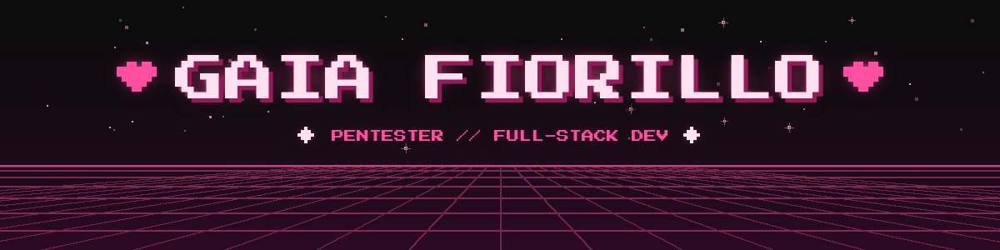
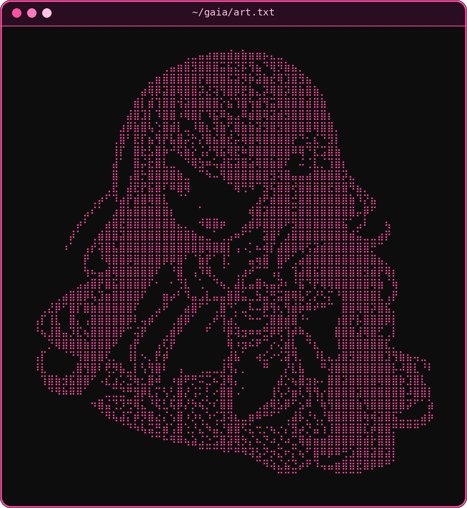
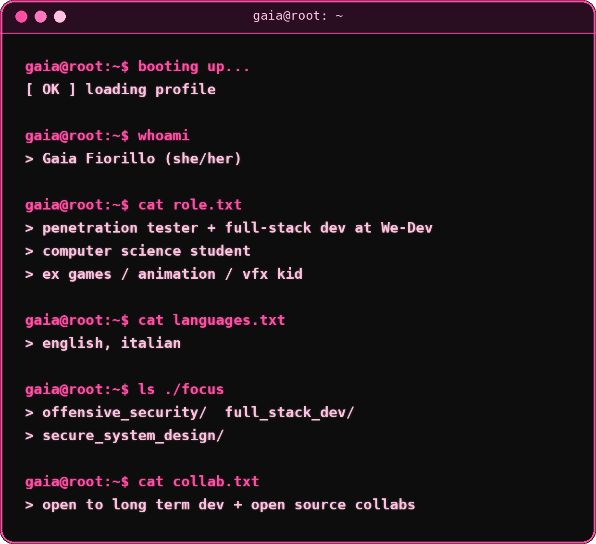
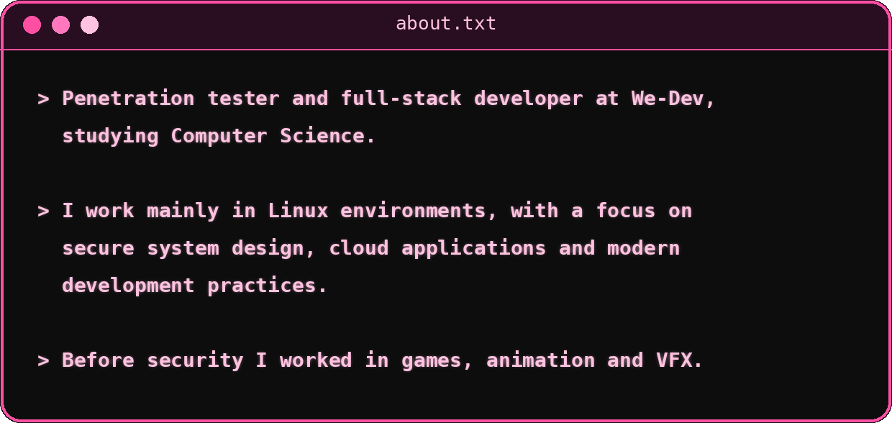
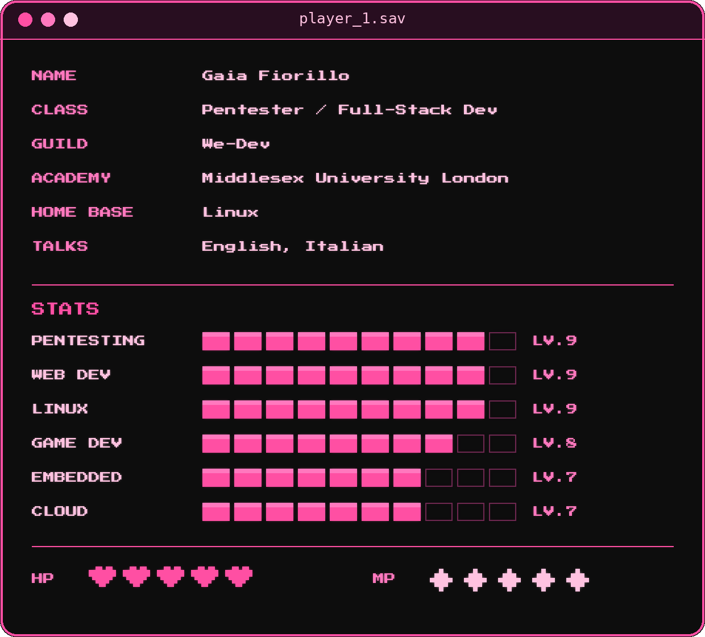
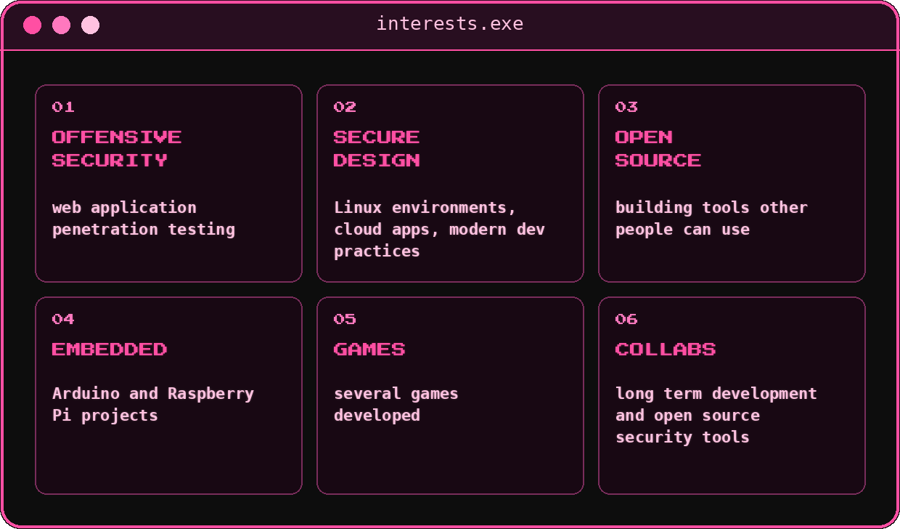

<div align="center">




<br/>


<br/><br/>


<br/><br/>


<br/><br/>



<br/>



<br/><br/>



<br/>


<br/><br/>


<br/><br/>


<br/>



<br/><br/>


<br/><br/>


<br/><br/>



<br/>


<br/><br/>


<br/><br/>


<br/><br/>


<br/><br/>


<br/><br/>

<a href="https://github.com/gaiafiorillo?tab=followers"></a>


<br/><br/>


<br/><br/>


<br/><br/>


<br/><br/>

<a href="https://github.com/gaiafiorillo" target="_blank">

</a>
<a href="https://www.linkedin.com/in/gaia-fiorillo-611884279/" target="_blank">

</a>
<a href="https://stackoverflow.com/users/19377719/gaia" target="_blank">

</a>
<a href="mailto:gaiafiorillo06@gmail.com">

</a>
<a href="https://www.buymeacoffee.com/gaiaf" target="_blank">

</a>

<br/><br/>

```
⠀⠀⠀⠀⠀⠀⠀⠀⠀⠴⣠⡀⡀⠀
⠀⢀⡔⠲⢄⡠⠖⠢⡀⠀⠈⠠⣖⠄
⠀⠘⢇⠀⠀⠀⠀⡠⠃⠀⠀⠀⠀⠀
⠀⠀⠈⠙⢄⡠⢋⣁⡀⠀⣀⣀⠀⠀
⢘⡀⠀⠀⠀⠀⡏⠀⠈⠚⠁⠀⡏⠀
⠈⠚⡀⢄⡀⠀⠘⠦⣀⢀⣠⠔⠁⠀
⠀⠀⠀⠑⠊⠀⠀⠀⠀⠑⠁⠀⠀⠀

```


</div>
